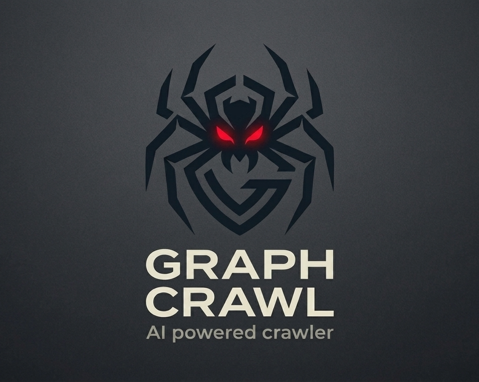
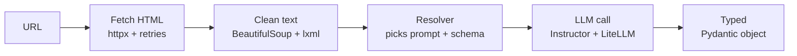

<p align="center">  </p> 

<h1 align="center">GraphCrawl AI 🕷️🕸️</h1>

<p align="center">
  <strong>Turn any webpage into clean, typed data with one async function call.</strong>
</p>

<p align="center">
  
  
  
</p>

GraphCrawl AI is an open-source Python library that fetches a public webpage, strips it down to the text that matters, and uses an LLM to return a validated [Pydantic](https://docs.pydantic.dev/) object. No HTML parsing, no selectors, no prompt engineering.

```python
result = await crawl_url(
    source="https://github.com/utsabkhadka0710/graphcrawl_ai",
    quick_option="summary",
    model="gemini/gemini-2.5-flash",
)

print(result.model_dump_json(indent=2))
```

Example output (shortened; the exact wording varies by model):

```json
{
  "status": "success",
  "summary": "GraphCrawl AI is an AI-powered Python library designed for web scraping and extracting structured, typed data from public webpages. It streamlines the process by fetching, cleaning HTML, and then using a Large Language Model (LLM) to extract information into Pydantic models, avoiding manual HTML parsing. ...",
  "key_takeaways": [
    "GraphCrawl AI is a Python library for AI-powered web scraping and structured data extraction.",
    "It converts any public webpage into structured, typed data using Pydantic models, eliminating the need for HTML parsing or prompt engineering.",
    "..."
  ]
}
```

> ⚠️
> **Alpha software.** The core flow works end-to-end, but the API will keep changing and it is **not production-ready yet**. See [Known limitations](#known-limitations) before relying on it.

## Contents

- [Features](#features)
- [How it works](#how-it-works)
- [Installation](#installation)
- [Quick start](#quick-start)
- [Choosing a model and setting credentials](#choosing-a-model-and-setting-credentials)
- [Usage](#usage)
- [Response models](#response-models)
- [Error handling](#error-handling)
- [Project structure](#project-structure)
- [Development and testing](#development-and-testing)
- [REST API](#rest-api)
- [Known limitations](#known-limitations)
- [Responsible use](#responsible-use)
- [Roadmap](#roadmap)
- [Contributing](#contributing)
- [License](#license)

## Features

- **One function.** `crawl_url()` handles fetching, cleaning, prompting, and validation.
- **Typed output.** Every result is a Pydantic model, so you get validation and `.model_dump()` / `.model_dump_json()` for free.
- **Built-in quick options.** `summary`, `contacts`, and `products` ship with tuned prompts and response schemas.
- **Bring your own prompt and schema.** Describe what you want and define the shape of the answer as a Pydantic class.
- **Multi-model.** Built on [Instructor](https://python.useinstructor.com/) and [LiteLLM](https://docs.litellm.ai/), so you switch providers by changing one string.
- **Async-first.** `crawl_url()` is a coroutine, so it fits naturally into async apps and lets you crawl many pages concurrently.
- **Sensible fetching.** Configurable timeouts and retries, with clear, specific exceptions.
- **Open source.** MIT licensed.

## How it works



1. **Fetcher** (`extraction/html_from_url.py`): downloads the page with `httpx`. Server errors (5xx) and timeouts are retried; client errors (4xx) and network failures fail immediately.
2. **Parser** (`extraction/text_from_html.py`): removes scripts, styles, hidden elements, dialogs, cookie and newsletter overlays, and link-heavy navigation/footer blocks, then normalizes whitespace.
3. **Resolver** (`resolver/url_resolver.py`): chooses the prompt and response schema for your `quick_option` (or uses your own).
4. **LLM engine** (`llm/engine.py`): sends the cleaned text to your chosen model through Instructor and LiteLLM, and parses the reply into the schema. Provider failures are mapped to specific exceptions.

## Installation
 
GraphCrawl AI is not on PyPI yet, so install it from source. **Requires Python 3.11 or newer** (the pinned versions below were verified on Python 3.12).
 
```bash
git clone https://github.com/utsabkhadka0710/graphcrawl_ai.git
cd graphcrawl_ai
```
 
Create and activate a virtual environment:
 
```bash
# macOS / Linux
python3 -m venv .venv
source .venv/bin/activate
```
 
```powershell
# Windows (PowerShell)
python -m venv .venv
.venv\Scripts\Activate.ps1
```
 
### Recommended: install the exact tested versions
 
The repo ships a [`requirements-lock.txt`](requirements-lock.txt) that pins every dependency, direct and transitive, to the versions the project was built and tested with (for example `litellm==1.93.0`, `instructor==1.15.4`, and `pydantic==2.13.4`). Install from it first, then install GraphCrawl on top **without letting pip touch the dependencies**:
 
```bash
pip install -r requirements-lock.txt
pip install -e . --no-deps
```
 
The lock file also includes the test tools (`pytest`, `respx`, and friends), so you can run the test suite straight away. Platform-specific packages such as `uvloop` (which has no Windows build) are skipped automatically where they don't apply.
 
> **Why pin?** `pyproject.toml` only lists package names, so a plain `pip install -e .` pulls whatever the newest releases are today. Fast-moving libraries like LiteLLM and Instructor change often, and a newer release can change behavior or break the code. The lock file removes that risk.
 
### Alternative: install the latest versions
 
If you want to try the newest releases (for example to test compatibility), install from `pyproject.toml` instead:
 
```bash
pip install -e .          # runtime only
pip install -e ".[dev]"   # plus test tools
```
 
Only the pinned versions above are tested, so anything newer may behave differently.

## Quick start

You need an API key for whichever provider you choose (or a local model, see below).

```python
import asyncio
from graphcrawl_ai import crawl_url

async def main():
    result = await crawl_url(
        source="https://example.com/",
        quick_option="summary",
        model="gemini/gemini-2.5-flash",
        api_key="your_api_key_here",
    )
    print(result.summary)
    print(result.key_takeaways)
    print(result.model_dump_json(indent=2))

asyncio.run(main())
```

Example output (the exact wording varies by model):

```json
{
  "status": "success",
  "summary": "This domain is designated for use in documentation examples.",
  "key_takeaways": [
    "This domain can be used in documentation examples without needing permission.",
    "It should be avoided for use in operations."
  ]
}
```

> **Notebook?** In Jupyter, skip `asyncio.run()` and call `result = await crawl_url(...)` directly in a cell.

## Choosing a model and setting credentials

`model` is a [LiteLLM](https://docs.litellm.ai/docs/providers) model string, in the form `provider/model-name`.

| Provider | Example `model` | Environment variable |
|---|---|---|
| Google Gemini | `gemini/gemini-2.5-flash` | `GEMINI_API_KEY` |
| OpenAI | `openai/gpt-4o` | `OPENAI_API_KEY` |
| Anthropic | `anthropic/claude-sonnet-5-5` | `ANTHROPIC_API_KEY` |
| Ollama (local) | `ollama/llama3.1` | none (needs Ollama running locally) |

Model names change often, so check your provider's docs for the current list.

> **What has been tested:** the core flow has been exercised with Gemini models and a local model through Ollama. Other providers should work through LiteLLM but haven't been verified in this project yet. Small local models may produce typos or miss fields, so check their output.

There are two ways to supply credentials.

**Option 1: pass `api_key` explicitly.** This is the most reliable option.

```python
result = await crawl_url(
    source="https://example.com",
    quick_option="summary",
    model="openai/gpt-4o",
    api_key="sk-...",
)
```

**Option 2: use environment variables.** If you omit `api_key`, LiteLLM looks up the standard variable for the provider in your `model` string. Copy `.env.example` to `.env`, fill in the key that matches your provider, and load it before calling `crawl_url()`:

```python
from dotenv import load_dotenv
load_dotenv()  # GraphCrawl does not do this for you
```

## Usage

### `crawl_url()`

```python
async def crawl_url(
    source: str = None,
    prompt: str = None,
    quick_option: Literal["summary", "contacts", "products"] = None,
    model: str = None,
    api_key: str = None,
    response_schema: type[BaseModel] | None = None,
    llm_timeout: float = 60,
    llm_retry: float = 3,
    crawl_timeout: float = 30,
    crawl_retry: float = 3,
) -> BaseModel
```

| Parameter | Required | Description |
|---|---|---|
| `source` | Yes | URL of the page to read. Must start with `http://` or `https://`. |
| `model` | Yes | LiteLLM model string, e.g. `"gemini/gemini-2.5-flash"`. |
| `quick_option` | One of this or `prompt` | `"summary"`, `"contacts"`, or `"products"`. Comes with a built-in prompt and schema. |
| `prompt` | One of this or `quick_option` | Your own extraction instructions. If you pass both, your `prompt` is used. |
| `response_schema` | Required with `prompt` | A Pydantic model class describing the shape of the answer. |
| `api_key` | No | Provider API key. Omit to use environment variables. |
| `llm_timeout` | No | Seconds to wait for the LLM. Default `60`. |
| `llm_retry` | No | Retry attempts for the LLM call. Default `3`. |
| `crawl_timeout` | No | Seconds to wait for the webpage. Default `30`. |
| `crawl_retry` | No | Retry attempts for the page fetch. Default `3`. |

The four timeout and retry values accept ints, floats, or numeric strings. They are rounded **up** to whole numbers (`2.5` becomes `3`). Anything non-numeric raises `InvalidDataError`.

### Quick options

| Option | Extracts | Returns |
|---|---|---|
| `"summary"` | A page summary and key takeaways | `UrlSummaryResponse` |
| `"contacts"` | Emails, phones, addresses, social links | `UrlContactsResponse` |
| `"products"` | Name, price, description, rating, units sold | `UrlProductsResponse` |

**Contacts**

```python
result = await crawl_url(
    source="https://company.com/contact",
    quick_option="contacts",
    model="gemini/gemini-2.5-flash",
)

print(result.contact_info.emails)
print(result.contact_info.phones)
print(result.contact_info.social_links)
```

**Products**

```python
result = await crawl_url(
    source="https://shop.example.com/category/headphones",
    quick_option="products",
    model="gemini/gemini-2.5-flash",
)

if result.products_found:
    for product in result.products:
        print(product.name, product.price)
```

### Custom prompt and response schema

Write your own instructions and describe the answer you want as a Pydantic model. A custom `prompt` **always** needs a matching `response_schema`, so the library knows how to shape and validate the reply.

```python
import asyncio
from typing import Optional
from pydantic import BaseModel
from graphcrawl_ai import crawl_url

class UserInfo(BaseModel):
    name: str
    age: Optional[int]
    contact_info: list[str]
    summary: str

class Schema(BaseModel):
    info: UserInfo

result = asyncio.run(crawl_url(
    source="https://github.com/some-user/",
    prompt="Extract detailed information about the user",
    response_schema=Schema,
    model="gemini/gemini-2.5-flash",
))

print(result.info.name)
print(result.model_dump_json(indent=4))
```

A runnable version lives in [`examples/live_demo_example.py`](examples/live_demo_example.py). It makes a real network request and a real LLM call.

### Tuning timeouts and retries

```python
result = await crawl_url(
    source="https://slow-site.example.com",
    quick_option="summary",
    model="gemini/gemini-2.5-flash",
    crawl_timeout=60,  # seconds to wait for the webpage
    crawl_retry=5,     # fetch attempts
    llm_timeout=120,   # seconds to wait for the LLM
    llm_retry=5,       # LLM retry attempts
)
```

### Crawling several pages concurrently

Because `crawl_url()` is async, you can fan out with `asyncio.gather`:

```python
urls = ["https://example.com", "https://example.org"]

results = await asyncio.gather(*[
    crawl_url(source=u, quick_option="summary", model="gemini/gemini-2.5-flash")
    for u in urls
])
```

Keep your provider's rate limits in mind when you do this.

## Response models

All built-in responses extend `UrlBaseResponse`, which carries a `status` field. Every response is a normal Pydantic model, so use `.model_dump()` for a dict or `.model_dump_json()` for JSON.

| Model | Fields |
|---|---|
| `UrlSummaryResponse` | `status`, `summary: str`, `key_takeaways: list[str]` |
| `UrlContactsResponse` | `status`, `contact_info` with `emails`, `phones`, `addresses`, `social_links` (each `list[str]`) |
| `UrlProductsResponse` | `status`, `products_found: bool`, `products: list[ProductItem]` |
| `ProductItem` | `name`, `price`, `description`, `rating`, `total_sold` (all `str`) |

## Error handling

Errors fall into three groups: invalid input to `crawl_url()`, failures while fetching the page, and failures while talking to the LLM. Every exception below is importable straight from `graphcrawl_ai`.

Each group has a base class, so you can catch a whole group at once: `CrawlError` (input), `FetchError` (page fetching), and `LLMError` (LLM calls).

| Exception | Group | Raised when |
|---|---|---|
| `UrlMissingError` | Input | `source` is missing or empty |
| `PromptMissingError` | Input | Neither `prompt` nor `quick_option` was given |
| `InvalidDataError` | Input | A parameter has an invalid value (check `.param_name`), including a missing `model` |
| `ResponseSchemaMissingError` | Input | A custom `prompt` was given without a valid `response_schema` |
| `InvalidUrl` | Fetch | The URL is malformed |
| `ProtocolError` | Fetch | The URL lacks `http://` or `https://` |
| `HTTPStatusError` | Fetch | The site returned an error status (4xx, or 5xx after retries) |
| `NetworkError` | Fetch | A connection or DNS failure |
| `RetryTimeoutError` | Fetch | The page kept timing out until retries ran out |
| `LLMAuthenticationError` | LLM | The provider rejected your API key (or denied permission) |
| `LLMNotFoundError` | LLM | The model name doesn't exist or isn't available to your account |
| `LLMTimeoutError` | LLM | The LLM call timed out |
| `LLMRateLimitError` | LLM | The provider rate-limited the request |
| `LLMContextWindowExceededError` | LLM | The page text is too long for the model |
| `LLMUnavailableError` | LLM | The provider is unavailable |
| `APIError` | LLM | A provider connection or API error |
| `LLMRetryError` | LLM | Instructor ran out of retries before getting a valid reply |
| `LLMUnknownError` | LLM | Any other LLM failure |

```python
from graphcrawl_ai import (
    crawl_url,
    PromptMissingError, InvalidDataError,
    HTTPStatusError, RetryTimeoutError,
    LLMAuthenticationError, LLMNotFoundError, LLMContextWindowExceededError,
)

try:
    result = await crawl_url(
        source="https://example.com",
        quick_option="summary",
        model="gemini/gemini-2.5-flash",
    )
except PromptMissingError:
    print("Provide either `prompt` or `quick_option`.")
except InvalidDataError as e:
    print(f"Bad value for parameter: {e.param_name}")
except (HTTPStatusError, RetryTimeoutError) as e:
    print(f"Could not load the page: {e}")
except LLMAuthenticationError:
    print("Check your API key.")
except LLMNotFoundError:
    print("Check the model name.")
except LLMContextWindowExceededError:
    print("This page is too long for the chosen model.")
```

## Project structure

```
graphcrawl_ai/
├── graphcrawl_ai/
│   ├── __init__.py                  # Public exports: crawl_url + common exceptions
│   ├── crawler/
│   │   └── crawl_url.py             # Public API: async crawl_url()
│   ├── extraction/
│   │   ├── html_from_url.py         # HTTP fetch with retry (httpx)
│   │   └── text_from_html.py        # HTML -> clean text (bs4 + lxml)
│   ├── resolver/
│   │   └── url_resolver.py          # Routes quick_option/prompt -> fetch + schema -> LLM job
│   ├── llm/
│   │   ├── client.py                # Instructor + LiteLLM async client
│   │   ├── engine.py                # Runs the LLM call, maps provider errors
│   │   ├── prompts.py               # Built-in prompts (summary / contacts / products)
│   │   └── config.py                # ModelSpec + stubs for future model fallbacks (unused)
│   ├── models/crawl_url/
│   │   ├── request_models/          # UrlExtractionRequest, ExtractionJobToLLM
│   │   └── response_models/         # UrlSummary/Contacts/ProductsResponse
│   ├── exceptions/                  # crawler, extraction, and llm exception classes
│   ├── utils/safe_cast.py           # Numeric coercion for timeout/retry params
│   └── tests/                       # pytest suite (HTTP mocked with respx)
├── api/                             # FastAPI skeleton (health checks only for now)
├── examples/
│   ├── live_demo_example.py         # Custom prompt + schema, real network + LLM call
│   └── basic_usage.py               # Empty placeholder
├── assets/logo.png
├── .env.example
├── CONTRIBUTING.md
├── LICENSE
├── pyproject.toml
└── requirements-lock.txt            # Pinned versions the project was tested with
```

## Development and testing

```bash
pip install -e ".[dev]"
pytest graphcrawl_ai/tests/
```

The suite covers input validation, HTML fetching (with mocked HTTP), content cleaning, LLM error mapping, and numeric coercion. The tests do not call any real website or LLM.

`examples/live_demo_example.py` is separate. It makes real requests, which makes it useful as a manual smoke test against a live provider.

### Updating the lock file

If you add or upgrade a dependency, update `pyproject.toml` first, then regenerate [`requirements-lock.txt`](requirements-lock.txt) from a clean environment:

```bash
python3 -m venv .venv-lock && source .venv-lock/bin/activate
pip install -e ".[dev]"
pip freeze --exclude-editable > requirements-lock.txt
pytest graphcrawl_ai/tests/
```

`pip freeze` drops platform markers, so re-add the one for `uvloop` afterwards (it has no Windows build):

```
uvloop==<version> ; sys_platform != "win32"
```

Confirm the tests still pass before committing the new lock file.

## REST API

A [FastAPI](https://fastapi.tiangolo.com/) app lives under `api/`, but it is only a skeleton: it exposes `/` and `/health`, and no crawling endpoints yet.

```bash
uvicorn api.main:app --reload
```

## Known limitations

GraphCrawl AI is early. Be aware of the following.

- **Static HTML only.** Pages are fetched with a plain HTTP client, so content rendered by JavaScript after load will not be seen. Login-protected pages are not supported.
- **No chunking.** The whole cleaned page is sent to the model. Very long pages can raise `LLMContextWindowExceededError`.
- **Heuristic cleaning.** Cookie banners and navigation are removed by tag, role, and keyword rules. Plain-prose notices with no identifying class or id can slip through.
- **Custom prompts need a schema.** There is no automatic schema for a custom `prompt`.
- **Limited provider verification.** See [Choosing a model](#choosing-a-model-and-setting-credentials).
- **Logging.** The fetcher configures `logging` at `INFO` level on import and logs each fetch attempt.
- **Heavier install than needed.** FastAPI and Uvicorn are installed as core dependencies, even though the REST API is only a skeleton.
- **Unfinished pieces.** `llm/config.py` is a stub that isn't used yet, and `examples/basic_usage.py` is empty.

## Responsible use

GraphCrawl AI sends a plain HTTP request with a `GraphCrawl/0.1.0` user agent. It does **not** check `robots.txt`, throttle requests, or identify you to the site. You are responsible for:

- following each site's terms of service and `robots.txt`,
- keeping request volume reasonable,
- not scraping personal data in ways that violate privacy law or the site's rules.

Also remember that the cleaned page text is sent to the LLM provider you choose. Do not use a hosted model on content you are not allowed to share with that provider.

## Roadmap

Directions suggested by the current code, roughly in priority order:

- [ ] Write `examples/basic_usage.py`
- [ ] Wire up real crawling endpoints in the REST API
- [ ] Model fallbacks and configuration (`llm/config.py`)
- [ ] Browser-based fetching (for example Playwright) for JavaScript-rendered pages
- [ ] Publish to PyPI

## Contributing

Contributions are welcome. See [CONTRIBUTING.md](CONTRIBUTING.md) for setup and conventions, and open an issue if you hit a bug or have an idea. When reporting a bug, include the URL, the `quick_option` or `prompt` you used, the full traceback, and your Python version and OS.

## License

Released under the [MIT License](LICENSE).